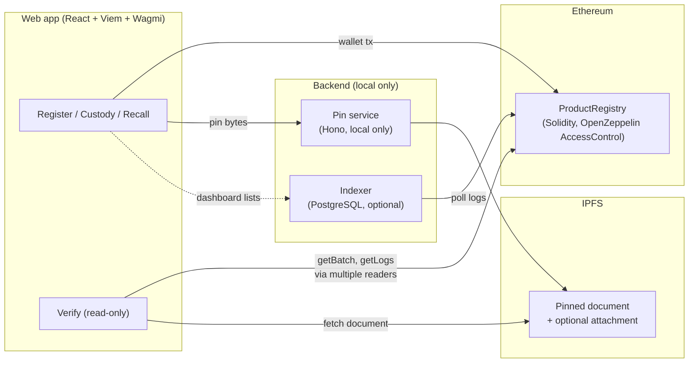

# ProofChain

ProofChain is a shared custody log for product batches, built on Ethereum.
A manufacturer registers a batch, custody moves only when the current holder
proposes a handoff and the named wallet accepts, and a recall role can freeze
the batch irreversibly. Anyone with the QR link can verify the full record —
registration, custody chain, document integrity, and recall status — by
reading the contract from independent Ethereum nodes, without connecting a
wallet.

**Live demo →** [proofchain-snowy.vercel.app](https://proofchain-snowy.vercel.app)

---

## Problem and solution

When a shipment moves from a manufacturer to a distributor to a retailer,
each company keeps its own spreadsheet. If those records disagree, there is
no common history to inspect. ProofChain puts the batch, the document
commitment (`keccak256` hash), the IPFS content identifier, the current
custodian, and the recall status in a single Ethereum contract. Custody
advances only through a propose-and-accept handoff signed by both parties.
A customer or auditor scans the QR code, and the verification page asks
several independent Ethereum nodes for the same record, displays the
handoff history with transaction links, and checks the product document
against the on-chain hash.

## Capabilities

| Capability | Description |
| --- | --- |
| **Register** | A manufacturer wallet registers a batch with its product document and IPFS copy. |
| **Custody handoff** | The current custodian proposes a transfer to a named wallet; that wallet accepts. |
| **Cancel** | The current custodian cancels an outstanding proposal. |
| **Recall** | A recall-role wallet freezes the batch. Recall is irreversible and clears any pending transfer. |
| **Verify** | Anyone opens the QR link. The page reads the contract and the IPFS document. No wallet required. |
| **Reader agreement** | The verifier queries multiple independent RPC readers and reports whether they agree at the same block. |
| **EIP-1186 storage proofs** | Optional account and storage-slot proofs verified against the readers' agreed state root. Separate from the green seal; not a consensus light client. |

### User flow

1. Manufacturer registers a batch → QR code is generated in the browser.
2. QR is printed and applied to the package.
3. Distributor scans QR, manufacturer proposes custody, distributor accepts.
4. At any point, anyone scans the QR to verify the full record.
5. If a problem is found, the recall role freezes the batch on-chain.

## Live Sepolia demo

`ProductRegistry` v2 is deployed on **Sepolia** (chain ID `11155111`) at
[`0x085156D33591d8DCce11703017D9B078bdEb837b`](https://sepolia.etherscan.io/address/0x085156D33591d8DCce11703017D9B078bdEb837b).

Two rehearsal batches demonstrate the lifecycle:

| Batch | Status | Custody path | Link |
| --- | --- | --- | --- |
| `PCB-2026-R02` | **Active** | A (manufacturer) | [Verify R02](https://proofchain-snowy.vercel.app/verify/11155111/0x085156D33591d8DCce11703017D9B078bdEb837b/PCB-2026-R02) |
| `PCB-2026-R01` | **Recalled** | A → B → C, then recalled | [Verify R01](https://proofchain-snowy.vercel.app/verify/11155111/0x085156D33591d8DCce11703017D9B078bdEb837b/PCB-2026-R01) |

The hosted app is a **verification demo**. It reads from four configured
public Sepolia readers and public IPFS gateways. Verification does not
require a connected wallet. The hosted site does not include a pin service,
so registration cannot complete there. To run the full write workflow
(registration, handoff, recall), use the local Anvil setup described below.

## Architecture



## Trust model and limitations

The contract records claims and the wallets that signed them.
**It does not prove physical goods are genuine.**

| Trust point | What it means |
| --- | --- |
| **Ethereum consensus** | Confirmed history is tamper-evident under ordinary Ethereum assumptions. A participant cannot quietly rewrite it. |
| **Administrator key** | A single admin grants manufacturer and recall roles. No multisig or time-lock in this version. |
| **Hosted website** | Whoever can change the deployed JavaScript can change what it displays. The CSP restricts network destinations but does not prove the code is honest. |
| **IPFS availability** | The CID and the hash detect a swapped or missing document, but do not keep the file online. If the document fetch fails, the page still shows on-chain data. |
| **QR code** | A QR is a pointer to the batch, not a seal on the box. A copied sticker opens the same record. ProofChain does not authenticate physical goods or prove a manufacturer's real-world identity. |
| **Reader agreement** | Agreement across multiple RPC readers makes a single broken reader easier to notice. It is not proof of Ethereum consensus. Providers can share infrastructure or fail together. |
| **EIP-1186 proofs** | Verifies account/storage proofs against a reader-reported agreed state root. It is not a light client and does not independently verify Ethereum consensus. Shown separately from the green seal. |
| **Green seal** | Requires a trusted deployment, passing document checks, and reader agreement. It is not a guarantee about the physical goods. |
| **Company name** | The company name in the product document is a claim made by whoever wrote that document. The manufacturer the contract recognizes is the wallet that signed the registration. |
| **Batch-code namespace** | Batch codes are a single global namespace. First registration wins. Squatting is an accepted property of this version. |

The full threat model is in [docs/threat-model.md](docs/threat-model.md).

## Technology stack

| Layer | Technology |
| --- | --- |
| Smart contract | Solidity 0.8.28, OpenZeppelin AccessControl, Foundry |
| Frontend | React 19, Viem, Wagmi, React Router, Vite |
| Metadata | Canonical JSON document, `keccak256` commitment, IPFS CID |
| Pin service | Hono, local Kubo, optional Pinata remote copy |
| Indexer | PostgreSQL 16, Viem log polling (optional for verification) |
| Verifier | Shared TypeScript package with CLI (`verify-batch`) and EIP-1186 proof verification |
| Hosting | Vercel (Sepolia build), Docker Compose (local) |
| Local chain | Anvil (Foundry) |

### Repository map

| Path | Description |
| --- | --- |
| `contracts/` | `ProductRegistry` — Solidity source, Foundry tests (unit, fuzz, invariant), deploy script |
| `packages/metadata/` | Canonical product document schema, batch ID, metadata hash |
| `packages/verifier/` | Verification logic, reader agreement, EIP-1186 storage proofs, CLI |
| `services/pin/` | Pins document bytes to local Kubo and optionally to Pinata |
| `apps/web/` | Registration, handoff, recall, and public verification UI |
| `indexer/` | PostgreSQL search index from contract logs — verification does not depend on it |
| `docker-compose.yml` | Local Anvil, PostgreSQL, Kubo, pin service, and indexer |
| `docs/threat-model.md` | Security assumptions and known limitations |

## Local setup

**Prerequisites:** Node.js ≥ 24, pnpm 12.16.1, Foundry, Docker.

```sh
pnpm install --frozen-lockfile
cp .env.example .env
cp .env.example apps/web/.env
```

Set `PRIVATE_KEY` in the **root** `.env` to Anvil account A's development key
(see table below). The example file already sets the admin, manufacturer, and
recall addresses to account A.

> [!WARNING]
> The keys below are Anvil's **public development keys**. They are safe only
> for the local Anvil chain. **Never use them on Sepolia or mainnet.**
> Never put a real private key in `apps/web/.env`.

| Account | Demo role | Address | Development key |
| --- | --- | --- | --- |
| A | Manufacturer + recall | `0xf39Fd6e51aad88F6F4ce6aB8827279cffFb92266` | `0xac0974bec39a17e36ba4a6b4d238ff944bacb478cbed5efcae784d7bf4f2ff80` |
| B | Accepts from A, proposes to C | `0x70997970C51812dc3A010C7d01b50e0d17dc79C8` | `0x59c6995e998f97a5a0044966f0945389dc9e86dae88c7a8412f4603b6b78690d` |
| C | Accepts from B | `0x3C44CdDdB6a900fa2b585dd299e03d12FA4293BC` | `0x5de4111afa1a4b94908f83103eb1f1706367c2e68ca870fc3fb9a804cdab365a` |
| D | Proposes without custody (rejected) | `0x90F79bf6EB2c4f870365E785982E1f101E93b906` | `0x7c852118294e51e653712a81e05800f419141751be58f605c371e15141b007a6` |

Start the local stack:

```sh
docker compose up --build -d
```

Deploy the contract and grant roles:

```sh
set -a && . ./.env && set +a
forge script script/Deploy.s.sol:Deploy \
  --rpc-url http://127.0.0.1:8545 --broadcast --root contracts
```

The deploy script prints the contract address. On a fresh Anvil chain, account
A's first contract is `0x5FbDB2315678afecb367f032d93F642f64180aa3`, already
listed as the local deployment in `apps/web/trusted-deployments.json`. Set
`CONTRACT_ADDRESS` in the root `.env` to the printed address if it differs.

Start the dev server:

```sh
pnpm --dir apps/web dev
```

Open [http://localhost:5173](http://localhost:5173). In MetaMask, add Anvil as
a network (RPC `http://127.0.0.1:8545`, chain ID `31337`, currency ETH) and
import the Anvil accounts above.

### Demo walkthrough

The registration form is pre-filled with a sample batch (`PCB-2026-001`).
To rehearse the full sequence, use a fresh batch code such as `PCB-2026-R01`:

1. **Account A** registers the batch → QR code appears after the transaction succeeds.
2. Open the verification link. The page shows the document, registering wallet, and active status.
3. **A** proposes custody to **B**. **B** accepts.
4. **B** proposes custody to **C**. **C** accepts. The page lists both handoffs.
5. **D** tries to propose — the contract reverts with `NotCurrentCustodian`.
6. **A** recalls the batch. The verification link now shows it as recalled.

After changing the contract source, rebuild the ABI:

```sh
forge build --root contracts
pnpm --dir apps/web generate:abi
```

## Independent verification

You can verify live batches without using the website's JavaScript.

**CLI verifier** (from a clean checkout):

```sh
pnpm install --frozen-lockfile
pnpm verify-batch \
  'https://proofchain-snowy.vercel.app/verify/11155111/0x085156D33591d8DCce11703017D9B078bdEb837b/PCB-2026-R02' \
  --gateway https://amethyst-abundant-seahorse-898.mypinata.cloud \
  --gateway https://gateway.pinata.cloud
```

**Direct on-chain read** with Foundry's `cast`:

```sh
cast call 0x085156D33591d8DCce11703017D9B078bdEb837b \
  'getBatch(bytes32)((string,address,address,bytes32,string,uint8,uint64))' \
  0xe9f429beedc9e905a5caa11f8dbacc983983c3b63458d361b0fc7d8d8fdb7d6f \
  --rpc-url https://ethereum-sepolia-rpc.publicnode.com
```

## Tests

```sh
forge test --root contracts        # Solidity unit, fuzz, and invariant tests
pnpm test                          # Metadata, verifier, pin, indexer, and web tests
pnpm check                         # Full gate: format, build, all tests, type-check,
                                   # hosted build (mode sepolia), bundle secret scan
```

Docker is not required for tests.

## Security notes

- The contract has been analyzed with Slither 0.11.6 (zero findings). The
  Foundry test suite (unit, fuzz, invariant) is the executable specification.
- The contract is **not upgradeable**. A fix means deploying a new contract.
  Old QR links keep pointing at the contract they were printed for. The
  trusted-deployment list can contain multiple deployments.
- Confidential data should not be placed on the public chain or IPFS. A hash
  does not make the underlying document private once it is published.
- The `pnpm check` gate includes a bundle scan that checks for sensitive
  variable names, known Anvil development keys, and configured
  `PRIVATE_KEY`/`PINATA_JWT` values from the root `.env`. It is not a
  general-purpose secret detector.

For the full threat model — including admin key risks, IPFS pinning loss,
custody history bounds, and Sepolia gas observations — see
[docs/threat-model.md](docs/threat-model.md).
